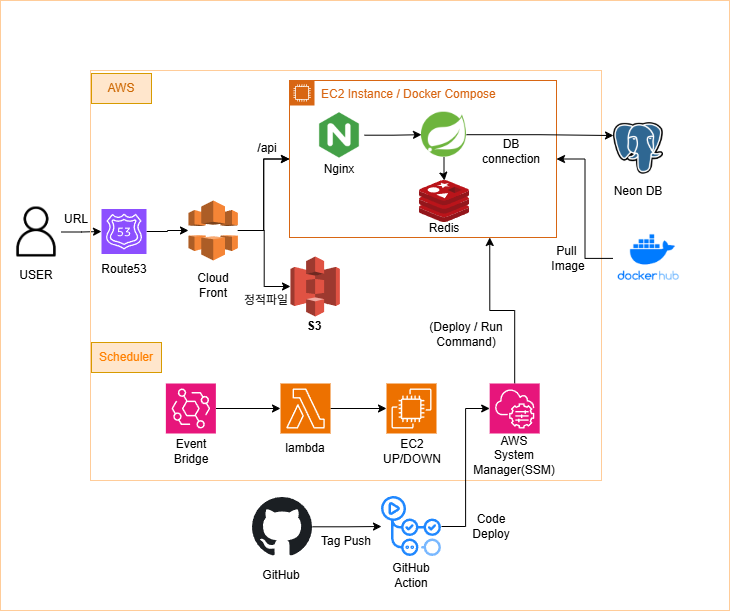

## Project overview

I proposed a club portal to consolidate investment reports and replace manual attendance tracking, then led a **14-person FE/BE/AI/Design team** from September to November 2025, before handing over leadership.

| Area | Stack |
|---|---|
| Application | React, Vite PWA, Spring Boot, PostgreSQL, Redis, Docker Compose |
| Process | GitHub Actions, JaCoCo, Jira |
| Cloud | EC2, S3, CloudFront, IAM, EventBridge, Lambda |

## Collaboration and delivery

Separate FE and BE sprints made API readiness unclear and delayed integration. I reorganized work around features, pairing frontend and backend tasks, and connected Jira issues to GitHub PRs and deployments.

I established CODEOWNERS, PR rules, a branch strategy, automated builds/tests, and a JaCoCo coverage target of at least 70%. When coursework delayed sprints, I temporarily relaxed the testing target to complete the MVP, investigated server logs, and clarified API misunderstandings between FE and BE.

## Infrastructure and recovery

An EC2 t3.micro instance became unresponsive while starting Spring Boot containers. Instance logs and `free -h` identified memory exhaustion. Moving to t3.medium and adding 1GB swap stabilized the environment.

- EC2 with GitHub Actions deployment automation
- S3 and CloudFront for static assets
- PostgreSQL and Redis
- SSM Session Manager for operations without SSH keys
- EventBridge and Lambda to limit operating hours to 09:00–18:00

## Product modules

GPS-based attendance and exceptions; team boards and file sharing; strategy backtesting; AI quant-bot trading records and dashboards; a points-based stock prediction game.

My role centered on service planning, collaboration structure, backend work, quality criteria, infrastructure, and deployment.

[Source repository](https://github.com/SISC-IT/sisc-web)
