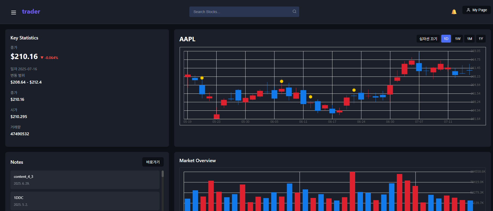
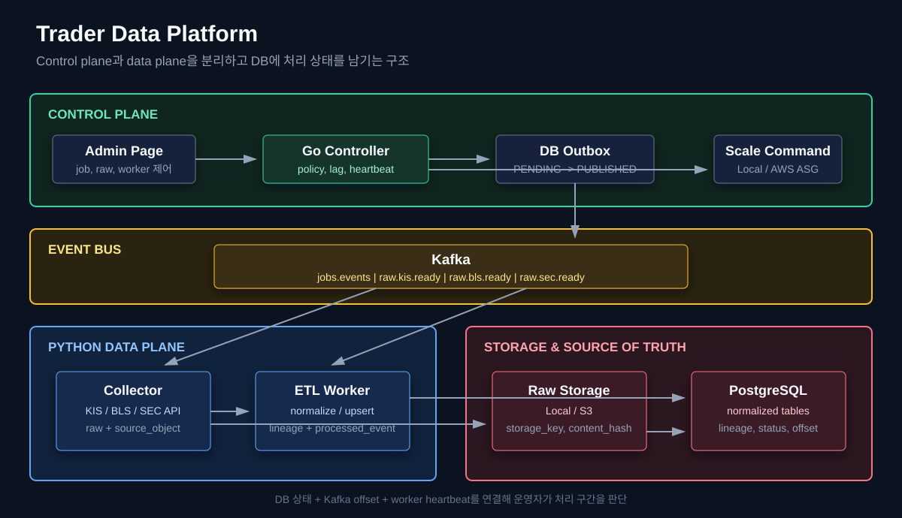
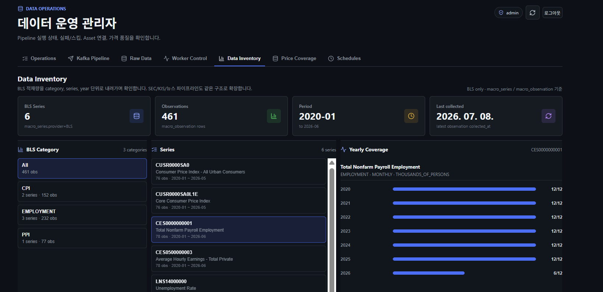
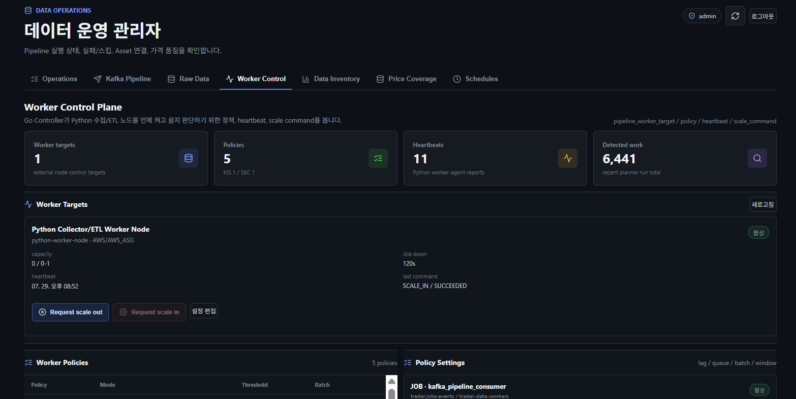

Trader connects charts, investment journals, and a realtime canvas so users can revisit investment decisions and outcomes. React Flow nodes and edges visualize their reasoning alongside stock prices, macroeconomic data, and financial statements.

## Project overview

| Item | Scope |
|---|---|
| Period | Jan 2025 – Present · Solo project |
| Features | Group/personal canvases, journals, chart markers, financial and macroeconomic data |
| Backend | Spring Boot, JPA, PostgreSQL, TimescaleDB, Redis, Kafka |
| Frontend | React, React Flow, WebSocket |
| Data | Go Controller, Python Workers, raw preservation and ETL lineage |
| Scale | About 10,000 symbols and over 26 million OHLCV rows; KIS, BLS, SEC |
| Validation | k6, JFR/JMC, Grafana, AWS ASG Worker control |

## Product screen {#product-screen}

The chart connects 90-day OHLCV queries with price candles, key statistics, and journal markers.

## Selected results

These figures come from separate load and failure scenarios.

| Experiment | Before | After |
|---|---|---|
| Stock chart p95 at 300 RPS | 7,247ms | **235ms**, meeting the 300ms target |
| WebSocket delivery within 200ms, after fixing write collisions | 0.38% | **99.97%** |
| Old GC total time, 90-second main load | 3.47s | **2.22s**, about 36% lower |
| BLS ETL recovery | Two pending raw objects | **Both processed** after restart |
| AWS Python Worker control | Manual start/stop | **ASG 0 → 1 → 0**, based on lag and idle state |

## Data pipelines and Worker control {#data-platform}

The Go Controller creates jobs, relays the database outbox, measures Kafka lag, and issues Worker scaling commands. Python Collectors preserve external responses; ETL Workers upsert normalized records and record lineage. PostgreSQL records processing state, while Kafka delivers events and exposes backlog.

`source_object` and `storage_key` identify raw inputs, `record_lineage` links them to normalized records, and `processed_event` plus idempotency keys support duplicate handling. Database commits precede Kafka offset commits.

In the BLS restart test, raw-ready lag fell from 2 to 0. In the separate AWS test, job lag triggered scale-out from 0 to 1; zero lag and 120 seconds of idle heartbeat triggered scale-in to 0. The AWS evidence covers small BLS scenarios, not large-scale multi-broker HA.

[Data pipeline report](/en/reports/trader-data-platform/)

## Time-series query performance {#timescaledb-performance}

The initial query path lacked a composite index and the restored table lacked hypertable metadata. Indexing was measured separately at 10 RPS: p95 fell from 342ms to 32ms. With identical indexes at 300 RPS, the ordinary table reached 7,247ms; a hypertable with 90-day chunks and four space partitions reached 235ms.

The read-heavy workload loads about 10,000 rows once daily, so I prioritized pruning and planning overhead over write parallelism. The user-facing chart uses 1D data. Weekly, monthly, and yearly CAGG strategies remain design and validation work.

[TimescaleDB report](/en/reports/timescaledb-27x/)

## JPA queries and runtime profiling

I compared query structures using p95, GC, and allocations, then separated list previews from full-text detail queries. A database-side 20-character preview remained stable at 120 RPS, while full 10,000-character content and application-side truncation degraded around 26 RPS.

JFR/JMC then exposed repeated JWT validation in the request hot path. Removing it reduced Old GC total time from 3.47s to 2.22s at 60 RPS during the same 90-second main load.

[JPA report](/en/reports/jpa-tuning/) · [JFR/JMC report](/en/reports/jfr-jmc-hotpath/)

## Realtime collaboration {#websocket-realtime}

Serializing writes per session eliminated concurrent send errors. Coalescing volatile cursor/drag state and adding dirty flags then raised delivery within 200ms to 99.97% for 200 users and 20 senders at 20Hz. Committed edits retained an ordered delivery path.

Separate PoCs verified group-level load distribution, field-based conflict detection, and replay to a target Kafka offset before server failback. Historical auto-merge rules were later tightened to require review for server-side content changes.

[WebSocket performance](/en/reports/websocket-group-canvas/) · [Sharding](/en/reports/websocket-poc1-sharding/) · [Conflict handling](/en/reports/websocket-poc2-conflict/) · [Failback](/en/reports/websocket-poc3-failback/)

## Contract-driven design {#node-contract}

The actual domain change supplies the same fields and version to Node state, History, and Outbox. A successful business transaction commits all three atomically; post-commit cache work and external propagation are separate. Tests cover no-op behavior, rollback, and retry ownership. A Kafka ACK does not imply client receipt or exactly-once processing.

[Contracts and validation limits](/en/reports/node-contract-refactoring/)

## Reliability and operations {#reliability-operations}

Structured logs, trace IDs, Loki, and Prometheus connect requests to failures and resource usage. Redis failure paths fall back to database state where appropriate; durable event obligations use an outbox and Kafka recovery path.

Application outages trigger container restart through Grafana Alert → Lambda → SSM. The CPU automation test triggered ASG scale-out from one to two instances. Recovery policies and capacity settings are validated within documented scenarios.

[Observability](/en/reports/observability-system/) · [Failure handling](/en/reports/realtime-degrade-overview/) · [Capacity planning](/en/reports/slo-operating-capacity/) · [Automatic recovery](/en/reports/auto-recovery-scaleout/)

## Source code {#source-code}

- [trader-backend](https://github.com/Kosw6/trader-backend) — Spring Boot backend and realtime collaboration
- [trader-controller](https://github.com/Kosw6/trader-controller) — Go jobs, outbox relay, Kafka lag, Worker policy, AWS ASG control
- [trader-data](https://github.com/Kosw6/trader-data) — Python collection, raw storage, normalization, lineage, consumer processing
