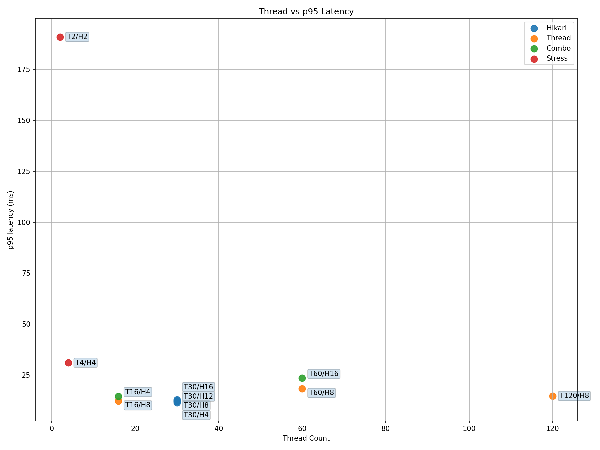
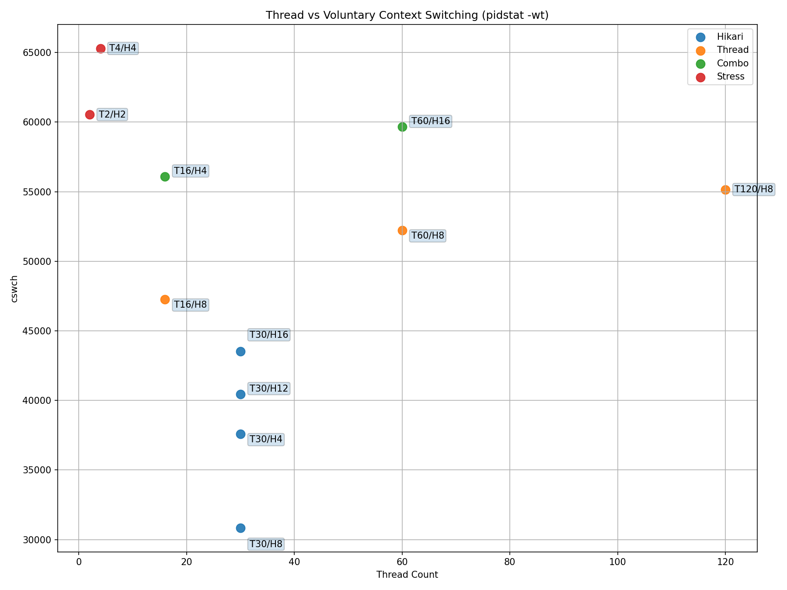

## Target and decision

The target was **p95 ≤ 300ms**. The selected baseline used **2 vCPU / 4GB for the application and for the database, 30 application threads, and a Hikari pool of eight**.

I evaluated k6 latency, CPU, pending database connections, error rates, and Linux context switching. Capacity needed an explanation tied to an SLO, rather than a binary claim that the service survived a test.

## Keep the experiments separate

| Experiment | Main load | Configurations |
|---|---|---|
| Baseline comparison | 150 RPS for 90s | Threads 16/30/60/120; Hikari 4/8/12/16 |
| Separate stress test | 300 RPS for 90s | Threads/pool 2/2 and 4/4 |

The stress points and baseline points must not be treated as matched-load p95 comparisons.

## Observations

- At baseline load, 30 threads/eight connections showed the most stable switching behavior.
- At 60 or more threads, switching increased without a throughput gain.
- Pool sizes of four and 12–16 showed higher switching despite no pending database connections.
- In the separate 300 RPS test, 2/2 reached p95 above 190ms and roughly 276 involuntary context switches, indicating saturation pressure in the undersized configuration.

Active DB connections were about one to two with no pending queue. `pidstat -wt` and `vmstat` suggested scheduling and thread contention as priorities for investigation. Those observations alone do not prove causation.

## Interpretation

The **30/8** setting is a baseline for this workload, not a universal recommendation. More threads and connections did not automatically add useful capacity. Changes to traffic or database work require another matched measurement.

## Detailed evidence

[Read the full Korean report and its linked experiment logs](/reports/slo-operating-capacity/). This English edition presents the design, key measurements, and validation limits.
