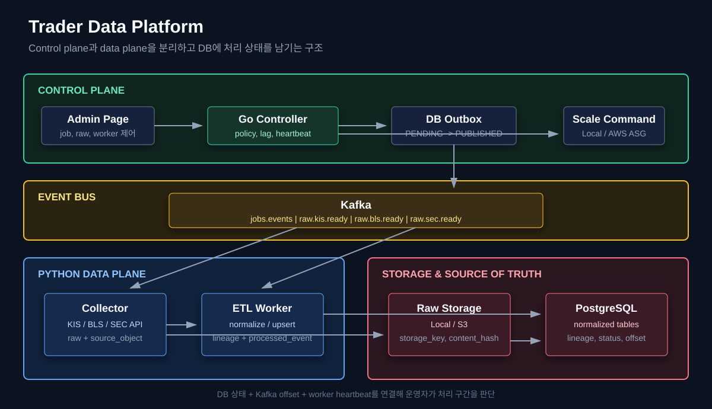
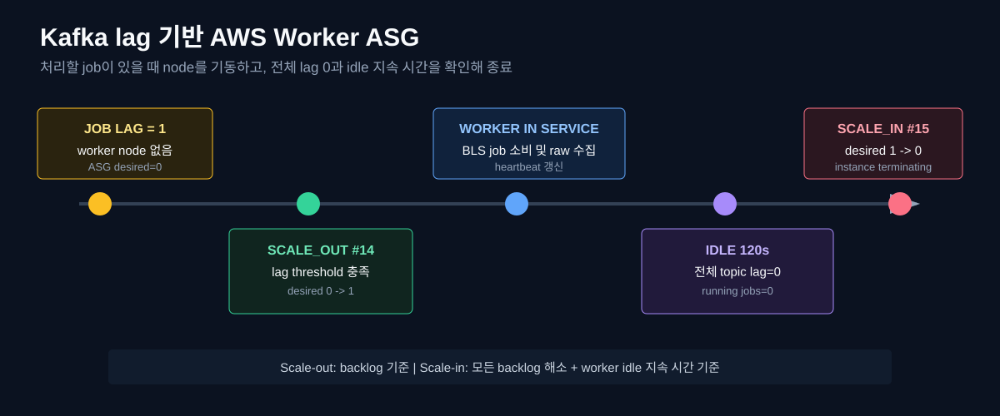

## Problem

KIS prices, BLS macroeconomic data, and SEC financial/disclosure data have different collection and transformation steps. After interruption, operators need to know what was preserved, what completed, and which inputs should be retried.

## Architecture {#architecture}

| Component | Responsibility |
|---|---|
| Go Controller | Jobs, outbox relay, raw-ready API, lag monitoring, scaling commands |
| Python Collector | External API calls, raw storage, `source_object` records |
| Python ETL Worker | Read raw input, upsert normalized records, record lineage |
| Kafka | Job/raw-ready delivery and consumer backlog |
| PostgreSQL/TimescaleDB | Jobs, outbox, raw state, lineage, processing results |

Separating collection from ETL preserves reproducible inputs, isolates API latency from transformation work, and allows source-specific backlog and Worker control. Database records determine completion; Kafka provides asynchronous transport and backlog measurements.

## State and lineage

| Record | Meaning |
|---|---|
| `pipeline_outbox` | PENDING, RETRY_WAIT, PUBLISHED, DEAD |
| `source_object` | COLLECTED, PROCESSING, PROCESSED, FAILED |
| `processed_event` | SUCCESS, FAILED, SKIPPED |
| `record_lineage` | Connection from raw input to normalized target records |
| `kafka_consumer_lag_snapshot` | Unprocessed work by topic and group |
| Worker heartbeat | Liveness, idle state, and idle duration |

Raw inputs are identified by `storage_key` and `content_hash`. Consumer processing uses idempotency keys and commits database results before Kafka offsets.

## Interruption recovery {#failure-recovery}

| Interruption point | Redelivery handling |
|---|---|
| Before PROCESSING is recorded | Another Worker can process the uncommitted Kafka message |
| After PROCESSING, before ETL commit | Rolled-back domain writes are retried |
| After ETL commit, before consumer ledger commit | Existing PROCESSED state and lineage avoid ETL repetition; ledger is completed |
| After consumer ledger commit, before Kafka commit | SUCCESS skips duplicate processing; offset can be committed |
| ETL failure | FAILED and error details remain for administrator retry or policy handling |

The Kafka-restart scenario verified outbox republication. In a separate BLS ETL restart test, two raw objects accumulated while the Worker was stopped; restarting it reduced raw-ready lag from **2 to 0**.

## AWS Worker scaling {#aws-worker-scaling}

The Go Controller observed job lag and changed Python Worker ASG desired capacity from **0 to 1**. After processing, zero lag plus **120 seconds of idle heartbeat** changed it from **1 to 0**. Scale-out command 14 and scale-in command 15 succeeded; BLS job item 42 was collected.

## Operations and limits

Admin views expose jobs/retries, outbox and topic lag, raw-to-lineage progress, heartbeats, and scaling commands. DB, Kafka, and Controller use On-Demand infrastructure in this design; replayable Python Workers are the candidate for ASG/Spot execution.

KIS, BLS, and SEC collection/ETL structures are implemented. AWS end-to-end evidence covers small BLS scenarios, including the two-object restart test. Kafka uses a single-broker smoke-test setup; replica/ISR validation, Spot-based DB/Kafka HA, and large-scale reliability claims are outside this evidence. Container restart remains separate from node-level ASG scaling.

[Go Controller](https://github.com/Kosw6/trader-controller) · [Python data processing](https://github.com/Kosw6/trader-data)

## Detailed evidence

[Read the full Korean report and its linked experiment logs](/reports/trader-data-platform/). This English edition presents the design, key measurements, and validation limits.
